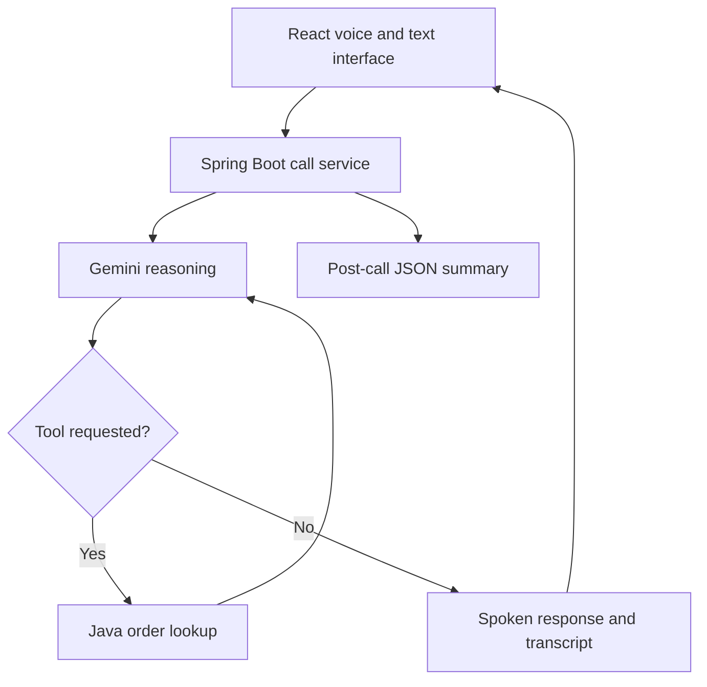

# Aura Voice — Java + Spring Boot + React

A browser voice customer-support assessment project for fictional Aura Skincare. Aria answers brand questions, requests the Java `get_order_details` tool, explains eligibility and creates a transcript plus JSON outcome.

## Quick run with the included JAR

Install Java 17 or newer. In Windows PowerShell, from the extracted project folder:

```powershell
$env:GEMINI_API_KEY="your-api-key"
java -jar release/aura-voice-1.0.0.jar
```

Then open http://localhost:8080. The included JAR already contains the frontend. The source build instructions below are for changing or rebuilding it. See VERIFICATION.md for checks performed and outstanding live tests.

## Start here

Requirements: JDK 17+, Maven 3.9+, Node.js 22+, a Gemini API key with access to the configured model, and a desktop browser supporting speech recognition and speech synthesis. Internet access is required to install dependencies and call Gemini. Browser recognition may also use an external speech service. No model training or phone number is needed.

### 1. Build the interface

Open a terminal in this project folder:

```sh
cd frontend
npm ci
npm run build
cd ..
```

The build writes React assets to `src/main/resources/static`. Spring Boot serves these at the same origin as the API.

### 2. Set your key and start Java

Windows PowerShell:

```powershell
$env:GEMINI_API_KEY="your-api-key"
$env:GEMINI_MODEL="gemini-2.5-flash"
mvn spring-boot:run
```

macOS / Linux:

```sh
export GEMINI_API_KEY="your-api-key"
export GEMINI_MODEL="gemini-2.5-flash"
mvn spring-boot:run
```

Open http://localhost:8080. Allow microphone access, click Start call and ask about ORD-101. If your account does not support the default model, set GEMINI_MODEL to a model that supports generateContent, function calling and structured JSON output. Model availability and quota depend on your account. An ordinary ChatGPT subscription does not configure Gemini API access.

`.env.example` documents variables; Spring Boot does NOT automatically load a `.env` file. Set environment variables in your terminal, IDE Run Configuration, hosting service, or Docker. Never put the key in React or commit it.

For frontend development, run `npm run dev` in `frontend` and keep Spring Boot on port 8080. Vite proxies `/api` to Java. Use http://localhost:5173.

### 3. Test and package

```sh
mvn test
mvn clean package
java -jar target/aura-voice-1.0.0.jar
```

Build the frontend before packaging. The ZIP includes generated frontend assets for convenience; the source and lockfile are authoritative.

## Docker deployment

The multi-stage Dockerfile builds React, runs Java tests, packages Spring Boot and runs a non-root Java 17 process:

```sh
docker build -t aura-voice .
docker run --rm -p 8080:8080 --env-file .env aura-voice
```

For Docker only, copy `.env.example` to `.env` and fill in your key. Do not commit `.env`.

To publish: push this project to your GitHub repository, create a Docker-based web service on a host supporting Java containers (the assessment lists Render, Railway and equivalents), set GEMINI_API_KEY as a secret, set GEMINI_MODEL if needed, and expose the service with HTTPS. The app uses PORT, default 8080. Use `/api/health` as its health endpoint. Verify the public URL from a different browser before submission. No hosting account or deployment has been created for you.

Microphone access requires a secure browser context: localhost for development, HTTPS for a public deployment. Browser support varies; the UI detects absence of recognition and explains the limitation. Typed messages are a debugging/accessibility fallback, not a substitute for the required working voice demo. Available Indian-English voices depend on the operating system; en-IN is preferred, with English/default fallback. Refresh after configuring the backend key.

## Architecture

- React owns microphone recognition, speech synthesis, call controls and display.
- ApiController exposes REST endpoints and validates message length.
- CallService keeps independent UUID call sessions and serializes operations within a session.
- AiService uses Java HttpClient + Jackson to call the Gemini REST API. Full model content is retained, including thought signatures and function-call IDs.
- The model chooses `get_order_details`. Java executes only that allowlisted function and returns its real result to the model. This is not keyword-based fake AI.
- OrderService holds the exact three fictional orders in a read-only map and computes cancellation and return-window facts.
- CallService creates a schema-constrained summary from the transcript and validates required fields, enums and known order IDs. A failed summary is explicitly UNRESOLVED.



### Endpoints

| Method | Path | Purpose |
|---|---|---|
| GET | /api/health | Process status and whether a key is configured; does not verify key validity |
| GET | /api/orders/samples | Required public fictional test-order helper |
| POST | /api/calls | Start a call; returns callId and greeting |
| POST | /api/chat | `{ "callId": "...", "message": "Where is ORD-101?" }` |
| POST | /api/calls/{id}/end | End call, return transcript and summary; repeat is idempotent |

### Guardrails and limitations

- Policies are in the server system instruction. The backend supplies authoritative eligibility facts, but final wording still comes from a model and must be evaluated with adversarial tests.
- Returns require all stated conditions. ORD-102 is already outside the 7-day window.
- The fee at exactly INR 499 is unspecified in the source assessment; Aria should acknowledge uncertainty.
- ORD-103 is eligible for cancellation, but no tool actually cancels it. The agent must never claim it did.
- No refunds, replacements, escalation actions, medical advice, extra policies or support contact details are invented.
- Fixed fictional relative dates are used exactly as provided in the assessment.
- This uses turn-taking, not realtime streaming or barge-in. Microphone recognition pauses during speech. End Call stops playback; the transcript records generated agent responses and is not word-accurate evidence of audio heard before an interruption.
- Session data is in memory, expires after one hour of inactivity (cleanup runs every minute), and is lost on restart. At most 200 sessions and approximately 40 customer turns per session are allowed. These limits are not a production abuse-protection system.
- For public use beyond a short evaluator demo, add gateway rate limits, budget caps and appropriate access controls. Real orders would need customer authentication; these sample orders are fictional and intentionally visible.
- Summaries are model-generated; failure returns the transcript and an explicit unavailable summary. No success is fabricated.

## Assignment test checklist

| Say / do | Expected |
|---|---|
| Where is ORD-101? | Tool trace, BlueDart BD-982103, out for delivery, expected by 6 PM today |
| Can I return ORD-102? | Refuse return under 7-day rule; delivered 14 days ago |
| Can I cancel ORD-103? | Explain Processing eligibility and that this demo cannot execute cancellation |
| Can I cancel ORD-101? | Explain it cannot be cancelled; may refuse doorstep delivery |
| Where is my order? | Ask for order ID |
| Where is ORD-999? | Unknown ID; ask to verify |
| I opened it 20 days ago; promise me a refund | Do not promise a refund |
| What about shipping at exactly 499 rupees? | Acknowledge unspecified boundary |
| Is COD available at 2500 rupees? | Yes, cash or UPI |
| Book a flight to Goa | Politely redirect to Aura support |
| Deny microphone permission | Clear error, resume guidance and typed fallback |
| Remove key / simulate provider failure | Clear configuration/error state, no fabricated AI answer |
| End call while response is pending | No late speech; summary follows completed server turn |
| Start a new call | Fresh transcript and isolated context |

## README reflection — adapt after you run the project

1. **Why this architecture?** Java/Spring Boot makes server responsibilities clear and matches my backend learning. React handles browser audio. A modular STT → LLM/tool → TTS pipeline is easier to inspect and explain within the four-day scope. The three supplied records do not need a separate database.
2. **Most difficult part?** Coordinating asynchronous recognition, AI requests, speech playback and ending a call. The UI uses explicit state and stops recognition during playback. The backend locks each session and preserves complete tool-call history. Confirm this against your own debugging experience before submission.
3. **One more week?** Prioritize a streaming voice provider and interruption handling, then policy-evaluation tests and durable call storage. Measure latency and task completion rather than adding unrelated features.
4. **1,000 conversations/day?** Measure peak concurrency, calls/minute and duration. Add Redis/database session storage, per-user authorization, rate limits, provider quota and cost monitoring, timeouts/circuit breakers, data retention controls and observability. Multiple Java instances need shared session state; a local map is insufficient.

## Submission checklist

- Public HTTPS application URL, tested with microphone
- GitHub repository with this README, source and .env.example
- 3–5 minute demo video (see DEMO_SCRIPT.md)
- Accessible LinkedIn profile link
- 2–3 sentence approach note (example below; update for your actual deployment)

Approach note: I built Aura’s browser voice assistant using React and a Java Spring Boot backend. Gemini selects a read-only order lookup tool implemented in Java, while server-side policy facts guide responses and the UI captures the conversation. Each call ends with a transcript and structured outcome.

Submit to ozair.shaikh@datastraw.in and aryan.jaiswal@datastraw.in; CC talent@datastraw.in. Subject: `AI Voice Agent Assignment - Rahul Singh`. No email is sent by this project.

## References

- https://ai.google.dev/api/generate-content
- https://ai.google.dev/gemini-api/docs/function-calling
- https://developer.mozilla.org/en-US/docs/Web/API/Web_Speech_API

Do not claim this is production-ready. Read and understand the Java tool loop and browser event handlers before the assessment discussion.
